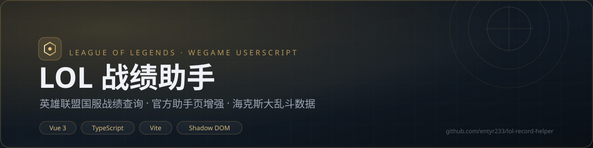
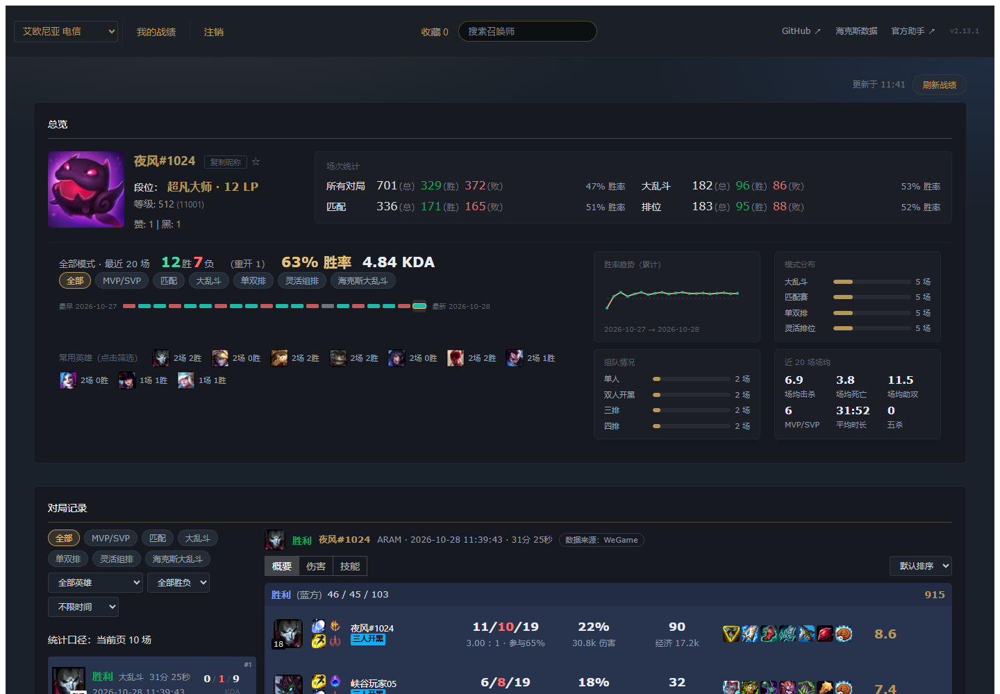
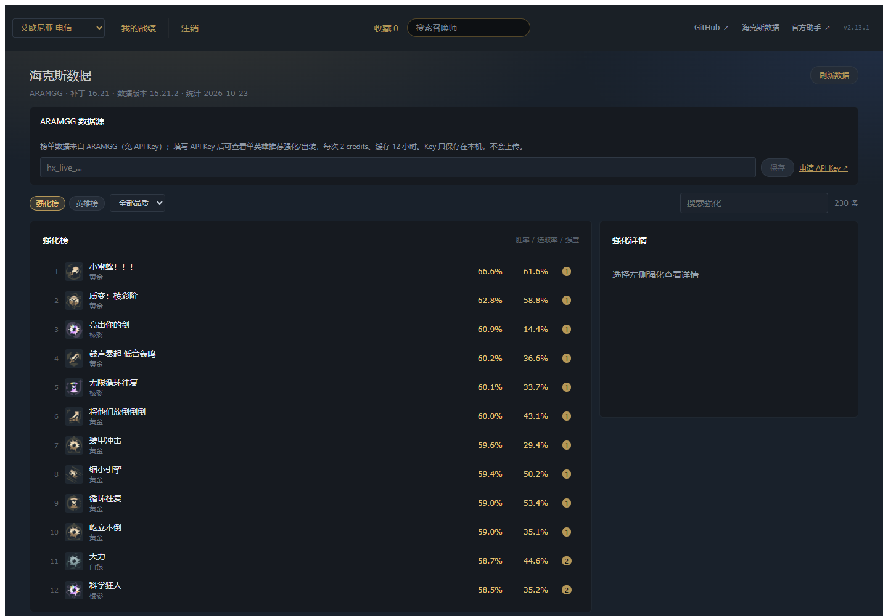

<p align="center">
  
</p>

<p align="center">
  <strong>在浏览器里，干净地查看英雄联盟国服真实战绩。</strong><br />
  自建战绩面板 · 官方 LOL 助手页增强 · 海克斯大乱斗数据
</p>

<p align="center">
  <a href="https://raw.githubusercontent.com/entyr233/lol-record-helper/master/userscript/lol-tft.user.js">
    
  </a>
  <a href="https://github.com/entyr233/lol-record-helper/tags">
    
  </a>
  <a href="https://github.com/entyr233/lol-record-helper">
    
  </a>
  <a href="https://github.com/entyr233/lol-record-helper">
    
  </a>
  <a href="https://github.com/entyr233/lol-record-helper">
    
  </a>
</p>

<p align="center">
  <a href="#快速开始">快速开始</a> ·
  <a href="#功能一览">功能一览</a> ·
  <a href="#界面预览">界面预览</a> ·
  <a href="#数据源与鉴权">数据源</a> ·
  <a href="#开发与构建">开发</a> ·
  <a href="#排障速查">排障</a>
</p>

## 快速开始

**只需要安装一个用户脚本。**

1. 安装脚本管理器：[ScriptCat](https://scriptcat.org/) 或 [Tampermonkey](https://www.tampermonkey.net/)。
2. **[点此安装 LOL 战绩助手](https://raw.githubusercontent.com/entyr233/lol-record-helper/master/userscript/lol-tft.user.js)**，在脚本管理器中确认安装。
3. 打开并登录 [WeGame](https://www.wegame.com.cn/)。页面右下角会出现 **「LOL 战绩助手」** 按钮，点击即可查询。

> **不用安装第二个脚本。** `lol-tft-ui.js` 是脚本的 `@resource` UI 资源，安装/更新时会自动下载；请勿把它当作用户脚本单独安装。
>
> 脚本壳约 **21KB**，在任意网站只注册菜单；UI 约 **300KB**，只在进入官方助手页或点击「LOL 战绩助手」时才加载。

**更新**：脚本会通过 `@updateURL` 自动检查更新，也可以重新打开上面的安装链接覆盖安装。

## 功能一览

| 模块 | 亮点 |
| --- | --- |
| **战绩总览** | 召唤师资料、等级/赞/黑、段位与 LP、四类场次统计与胜率；「近期表现」展示最近 20 场的胜率/KDA/连胜连败、累计胜率趋势、模式分布、组队情况与常用英雄 |
| **对局列表** | 翻页浏览；按模式、英雄、胜负、最近 7/30 天筛选；加载骨架屏、失败原位重试、键盘 ↑/↓ 切换对局 |
| **10 人详情** | KDA、伤害四系柱状图、装备、符文、召唤师技能、评分/补刀/经济；失败原因分类与来源诊断；WeGame / 掌盟来源徽标 |
| **搜索与收藏** | 按昵称搜索全大区玩家；收藏夹支持备注、分组、拖拽排序，并与最近搜索共用 |
| **官方助手增强** | 官方助手页右下角紧凑面板：登录、大区适配、打开官方战绩、一键呼出自建面板；面板可拖动、位置与收起状态本地记忆 |
| **海克斯大乱斗** | 强化榜 / 英雄榜、品质筛选、强化胜率与选取率、单英雄推荐强化/出装/加点；对局详情强化图标悬浮显示统计 |
| **体验细节** | Shadow DOM 隔离，不污染宿主页面；菜单在任意网站可见；UI 按需加载 |

### 两种入口

| 入口 | 位置 | 适合 |
| --- | --- | --- |
| 自建战绩面板 | 任意 WeGame 页面右下角「LOL 战绩助手」 | 快速查任意召唤师、查看完整对局与近期表现 |
| 官方助手增强 | `https://www.wegame.com.cn/helper/lol/` 右下角「LOL 助手增强」 | 保留官方页面布局，同时补齐登录、大区与自建入口 |

## 界面预览

> 以下截图使用本地 mock 数据，仅用于展示界面结构。





## 官方助手页增强

打开 `https://www.wegame.com.cn/helper/lol/`，右下角会出现可收起的「LOL 助手增强」面板：默认收起为紧凑标题条，点「展开」显示设置；按住标题栏可拖动位置，展开/收起状态和位置都记在本机。

- **官方登录**：走官方登录窗口；读到账号后自动刷新当前助手页（保留路径与页签）。登录窗口打不开时可点「去官网登录」，完成后回助手页点「已在官网完成登录，刷新此页」。
- **当前账号**：直接调官方 `GetSummonerInfo` 读取召唤师名（官方页面的名片组件在浏览器里经常不渲染，这里做兜底）。
- **战绩入口**：面板里并排「打开自建战绩面板 / 打开官方战绩」；官方助手的「战绩」页本身就是历史战绩页，不再重复放入口。
- **大区适配**：脚本在 `document-start` 给官方页面补最小 `top.TGP.status`（记住的大区 + cookie 账号）和 `p_uin`；如果仍提示「未选定大区」，自动改用 hash 参数（`uin / area_id / account_type`）兜底。面板里选的大区会被记住。
- **单面板**：官方助手页不再显示右下角悬浮「LOL 战绩助手」按钮，避免两个入口；其他 WeGame 页面仍保留悬浮按钮。

说明：这套入口负责登录、大区与跳转，不会修改官方页面内部状态；官方页面仍依赖 WeGame 登录态，和自建面板共用同一套会话与数据源。

## 海克斯大乱斗数据（ARAMGG）

顶栏「海克斯数据」进入 `aram` 路由：

- **强化榜**：230 个强化的胜率/选取率/强度排序，可按品质（棱彩/黄金/白银）筛选、按名称搜索；点开显示描述与该强化胜率最高的英雄。
- **英雄榜**：173 个英雄的海克斯大乱斗胜率/选取率排序；点开需要 ARAMGG API Key，展示推荐强化、核心装/出门装和技能加点。
- 对局详情里的强化图标悬浮提示会显示「名称 · 品质 · 胜率 · 选取率 · 描述」。

数据来自 [ARAMGG](https://aramgg.com/)（`data.dtodo.cn`）：榜单走公开客户端接口，免 Key；单英雄推荐走开发者接口，每次 2 credits，结果缓存 12 小时。API Key 在「海克斯数据」页填写，只保存在本机 `localStorage`，不会写进代码、仓库或上传；额度每天 200 credits（北京时间 08:00 重置）。榜单按需加载，打开战绩页不会自动请求。

## 数据源与鉴权

| 接口 | 用途 | 鉴权 |
| --- | --- | --- |
| `wegame.com.cn/api/v1/wegame.pallas.game.LolBattle/*` | 列表 / 资料 / 统计 / 详情 | WeGame 登录 cookie（同源自动携带） |
| `mlol.qt.qq.com/go/battle_info/get_battle_detail_h5` | 详情**回退源** | `.qq.com` 登录 cookie（QQ 侧） |
| `data.dtodo.cn/api/client/v1/*` | 海克斯强化榜 / 英雄榜 | 公开，无需 Key（限流） |
| `data.dtodo.cn/api/v1/zh-CN/champions/{id}.json` | 单英雄推荐强化 / 出装 | 本机填写的 ARAMGG API Key（2 credits/次） |

- 2026 现任格式：列表 `GetBattleList`；资料 `GetSummonerInfo`（含 `season` 段位）；统计 `GetBattleReport`
- 老接口被限制时（8000120 等）：先弹**官方人机验证**（TCaptcha + VerifyRecongnition）后自动重试；详情再失败则回退掌盟接口（`postMessage` 桥：脚本同时在 lol.qq.com 上运行，替面板做同源请求绕过 CORS）
- 登录态判断**以 cookie 为准**（`uin/p_uin`），不依赖 SDK 的 `isLogin()`（它在刷新后经常误报）
- 静态映射（符文/装备名）构建期固化，图标走版本化 CDN
- 诊断工具 `__LOL_TFT_DUMP__` 只读取被拒响应的结构，不包含 cookie

## 历史段位说明

WeGame 的 `GetBattleReport.season_list` 历史赛季数据已被服务端下线（v1.10.1 曾因此移除历史段位功能），当前面板不提供历史段位查询。掌盟 `get_rank_trend` 仍受登录态 / 分享 scene 限制，未自动接入；如果接受每个玩家手动粘贴掌盟历史段位分享链接，可以再评估恢复该入口。

## 开发与构建

```bash
npm install
npm run dev          # 本地演示站（mock 数据），http://localhost:5173
npm run typecheck    # vue-tsc
npm test             # vitest
npm run build:all    # typecheck + lib 构建 + userscript 打包 + 演示站
```

构建产物：

```text
dist/userscript/lol-tft.user.js   # 轻量壳
dist/userscript/lol-tft-ui.js     # UI，@resource 按需加载
userscript/lol-tft.user.js        # 入库副本，GitHub raw 直装/自动更新
userscript/lol-tft-ui.js          # 入库副本，UI 资源
```

- 开发默认走 mock（`sample/*.json` 扩展的示例数据），页面右下角有数据源状态条
- 要连真实数据：右下角「粘贴 Cookie」（或设 `LOL_TFT_COOKIE` 环境变量）；`LOL_TFT_MOCK=0` 强制真实接口
- 登录弹窗只在 WeGame 域内可用（登录 SDK 限制），本地开发看真实数据用 cookie 粘贴
- 脚本元信息使用 `http://*/*` + `https://*/*` 以便菜单在任意网站可见；只有 WeGame / `lol.qq.com` 页面会注入悬浮按钮和助手面板

## 目录结构

```text
src/api/          接口层（client/captcha/mlolDetail/transport/contracts/errors/types）
src/components/   UI 组件
src/composables/  组合式逻辑（翻页列表/异步取消/登录动作/用户参数）
src/const/        大区/队列/段位/评价 等映射
src/data/         构建期固化的符文/装备映射（node scripts/sync-static-data.mjs 更新）
src/styles/       全部样式（仅注入 Shadow DOM）
userscript/       用户脚本模板 + 构建后的壳/UI
scripts/          静态数据同步 / userscript 构建
tests/            契约/策略/生命周期/登录与组件测试
docs/             代码审查报告 / HAR 分析 / 迁移说明 / README 截图
```

## 排障速查

| 错误码 | 含义 |
| --- | --- |
| 8000101 | 请求参数不合法（会自动用规整后的 uin 重试） |
| 8000004 | 当前大区没有角色（换大区） |
| 8000009 / 8000021 | 对方设置了查询权限 |
| 8000022 / 8000120 | 需要人机验证（自动弹滑块） |
| 8000023 | 该用户已注销 |
| 8000102 | WeGame 登录失效（点「重新登录」或去 `/home/` 登录） |
| 1001 | 掌盟接口无 `.qq.com` 登录态（去 lol.qq.com 登录一次） |

如果「LOL 战绩助手」按钮出现但面板加载失败，先用 `__LOL_TFT_DUMP__()` 导出被拒接口结构，再反馈到 Issues。

## 合规与隐私

本项目调用 WeGame / 掌盟的非公开接口，仅供个人查询使用，不做批量抓取；不收集、不上传任何数据。诊断工具只读取被拒响应的结构，不包含 cookie。

## 相关文档

- 审查建议核查与处理：`docs/review-resolution-2026-10-28.md`
- 上游 Vue 2 审查归档：`docs/code-review-2026-10.md`
- HAR 分析（掌盟接口族逆向）：`docs/har-analysis-20261027.md`
- Vue2 → Vue3 迁移说明：`docs/migration-vue2-to-vue3.md`

---

<p align="center">
  <sub>数据来自 WeGame / 腾讯公开接口，仅供参考；本项目与 Riot Games、腾讯官方无关。</sub><br />
  <sub>原项目：<a href="https://greasyfork.org/zh-CN/scripts/454184">lol-tft（mscststs）</a> · 许可证：ISC</sub>
</p>
